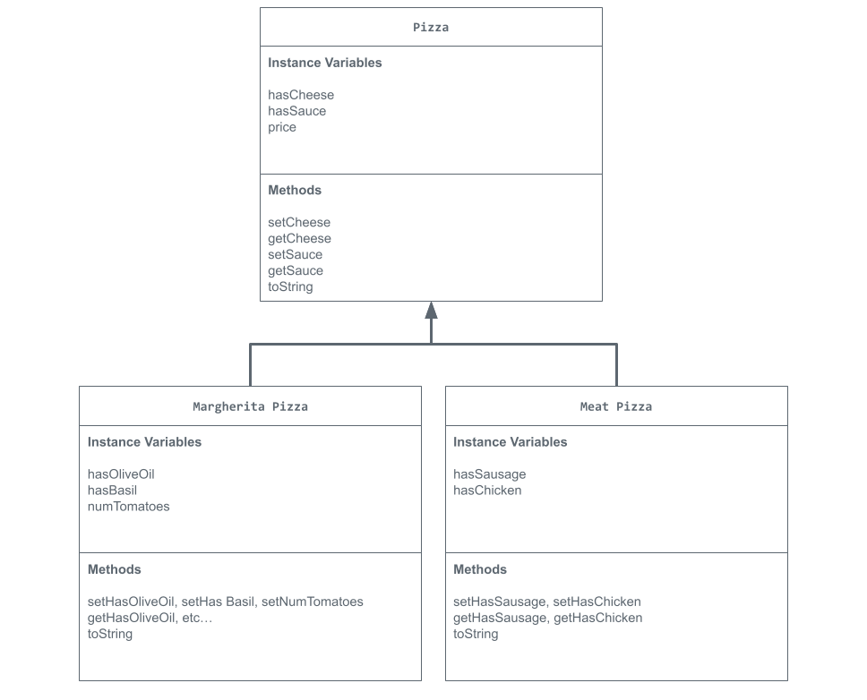

# Unit 2 - Store Management Project

## Introduction

You are opening a new business in your community! Businesses often need programs to manage the products and services they offer and track orders and requests from customers. Your goal is to create a store management system for your business.

## Requirements

Use your knowledge of object-oriented programming and class structure and design to create your store management system:
- **Create a class hierarchy** – Develop a superclass that represents a product or service your business offers and one or more subclasses that extend the superclass to represent more specific types of products or services.
- **Declare instance variables** – Declare instance variables in the superclass that are shared with the subclasses and instance variables in the subclasses that are not shared with the superclass.
- **Write constructors** – Write no-argument and parameterized constructors in the superclass and subclasses. Subclass constructors use the super keyword to call the superclass constructor.
- **Implement accessor and mutator methods** – Write accessor and mutator methods for instance variables that should be accessible and/or modifiable from outside of the class.
- **Implement a toString() method** – Write toString() methods in the superclass and subclasses that return information about the state of an object.

## UML Diagram

Embed your UML Diagram here. Upload the image of your UML Diagram to your repo, then use Markdown to insert your image here:

## Description

1. Write a description of your project here. Include what your store you made, and why you chose this topic. In your description, include as many vocab words from our class to explain how you represented the item/service from your store. If you have user input, explain how the user will interact with your store such as which questions are prompted to the user, what response is your program expecting, and how that is used to output information for your store in the console.
My store is a pizza store, I chose this topic because pizza is my favorite food and I'm Italian. I represented the different pizzas by creating a superclass called pizza that had instance variables for cheese and sauce in it and then I made two subclasses for Meat and Margherita pizza respectively. I made the user input values for all the different instance variables in the classes. The user has to make a regular pizza, a margherita pizza, and a meat pizza. Once the user inputs all the information it is printed to the console for the user to see.
2. How is this project related to STEAM (Science, Technology, Engineering, Art, and Mathematics)? Provide explicit examples from the project and details as possible. 
This project is related to STEAM because we had to develop and use models. I had to create the UML diagram to figure out how I would structure by superclasses, subclasses, and instance variables. I then used that model as the basis and structure for my code.
3. What SLOs did you demonstrate during completing this project?
A SLO I demonstrated during the completeion of this project was the critial thinking SLO. I had to critally think about what instance varibles I wanted to put into class and which ones I could put in the superclass that would be used by the subclasses.